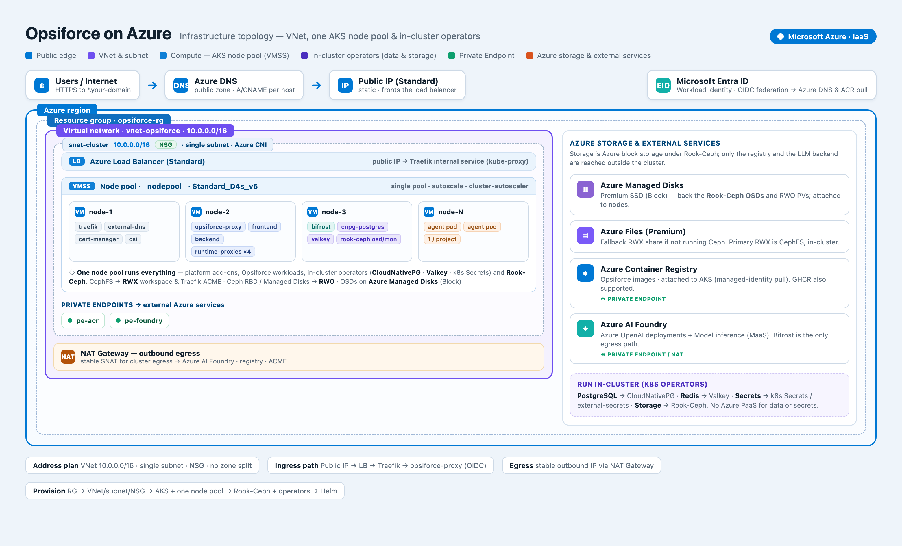

# Deploy to Azure (AKS)

> Provision the Azure infrastructure and cluster capabilities the Opsiforce Helm charts assume, then deploy the charts.

## Prerequisites

- An Azure subscription and an Infrastructure-as-Code stack (Pulumi or Terraform) that will own every resource below; this page is the specification that stack implements, not a command list.
- A domain you can delegate to an Azure DNS zone.
- An OIDC provider for the proxy login: Microsoft Entra ID or a Keycloak.
- An Azure AI Foundry (or Azure OpenAI) endpoint and key for the LLM gateway.
- [Deployment](deployment.md) read first, for what the charts deploy.



## Steps

1. Satisfy the platform contract. Everything here exists before the app charts are deployed:

   | Requirement | What it is for | Azure component |
   |---|---|---|
   | Kubernetes cluster and node pool | Runs all services and one pod per ProjectEnvironment | AKS, a single node pool |
   | ReadWriteMany storage | The shared workspace volume the `opsiforce` infra chart's CephFS PVC provides, mounted by the backend, the runtime proxies and every agent pod; Traefik shares its ACME store on it | Rook-Ceph CephFS; Azure Files as a fallback |
   | ReadWriteOnce block storage | Ceph OSDs; the in-cluster Postgres and Redis | Azure Managed Disks |
   | Ingress with a stable public IP | Terminates TLS, routes all `*.<your-domain>` hosts, serves Traefik `IngressRoute` CRDs | Traefik behind an Azure Standard Load Balancer |
   | Automatic DNS | Publishes each ingress host as a record | external-dns to Azure DNS |
   | Automatic TLS including wildcards | HTTPS on every host, per-environment app, VS Code and DB subdomains included | Let's Encrypt DNS-01 via Traefik or cert-manager |
   | PostgreSQL | The `opsiforce` and `bifrost` databases | CloudNativePG operator, in-cluster |
   | Redis-compatible cache | Timeout TTLs and event pub/sub | Valkey, in-cluster |
   | Secrets | Provider keys and admin credentials | Kubernetes Secrets, optionally external-secrets |
   | OIDC provider | User authentication at the proxy | Microsoft Entra ID or Keycloak |
   | LLM gateway backend | Bifrost routes every model call | Azure AI Foundry behind Bifrost |
   | Container registry | Serves the four Opsiforce images | Azure Container Registry or GHCR |

2. Network and cluster. One VNet with a single cluster subnet (Azure CNI) and one NSG; AKS with a single autoscaling node pool running platform add-ons, Opsiforce workloads, the operators, Rook-Ceph and the agent pods; the cluster's OIDC issuer and Workload Identity enabled so external-dns, Traefik or cert-manager and registry pulls authenticate by federated identity; outbound traffic through a NAT Gateway for a stable egress IP; Private Endpoints only for the registry and Azure AI Foundry.
3. Storage. Run Rook-Ceph in the cluster: a CephFS ReadWriteMany class for workspaces and code-server plus a Ceph RBD class, with OSDs on Azure Managed Disks attached to the nodes, multiple mons, replica factor 3 and a host-level failure domain. Expose CephFS under the storage-class name the `opsiforce` chart expects ([Persistence](../runtime/persistence.md)).
4. Ingress, DNS and TLS. Traefik behind a Standard Load Balancer with a stable public IP owns the `IngressRoute` CRDs the `opsiforce-proxy` chart creates and redirects HTTP to HTTPS; external-dns writes records into the Azure DNS zone, delegated at the registrar and granted through Workload Identity; certificates are issued by DNS-01 against Azure DNS through Traefik's ACME resolver or cert-manager, one of the two, reusing the external-dns identity.
5. Data, identity and registry. CloudNativePG provides the two databases (the app consumes a connection string); Valkey backs timeout TTLs and pub/sub; provider keys and admin credentials are Kubernetes Secrets; the OIDC provider's redirect URIs include your hostnames; attach an ACR with managed-identity pull or use a GHCR pull secret.
6. LLM backend. Point Bifrost's `custom-openai-*` providers' `base_url` at your Azure AI Foundry endpoint and make them key-ful with the Azure key in `helm/bifrost/values.{prod,local}.yaml`, keeping the provider ids in the values and in each `chat` key's config in lock-step; for Azure OpenAI deployments add Bifrost's native `azure` provider mapping model ids to deployment names; to keep App-side calls in-tenant, add Foundry to the `backend` key's provider list ([LLM Gateway](../gateways/llm-gateway.md)). Store the Foundry key in a Kubernetes Secret for Bifrost, keep Bifrost cluster-internal, and let only its egress reach Foundry.
7. Provision bottom-up:

   ```
   Resource group → VNet / single subnet / NSG → NAT Gateway
     → AKS + a single node pool (Workload Identity enabled)
       → Rook-Ceph → RWX + RWO storage classes
         → Traefik (public IP) · external-dns · cert-manager
           → CloudNativePG (Postgres) · Valkey (Redis) · registry + Azure AI Foundry (Private Endpoints)
             → Bifrost (upstream pointed at Foundry)
               → Opsiforce app charts  (see Deployment)
   ```

8. Deploy the app charts per [Deployment](deployment.md) with the environment-specific inputs changed: the hostnames (your DNS zone) and the ReadWriteMany storage-class name.

## Verify

- The ReadWriteMany class binds a `ReadWriteMany` claim.
- The ingress owns a stable public IP, external-dns creates records in the zone, and certificates are issued for your hosts, wildcards included.
- The in-cluster Postgres and Valkey are up.
- Bifrost reaches Azure AI Foundry through the cluster's egress, and its running image matches the pinned tag.
