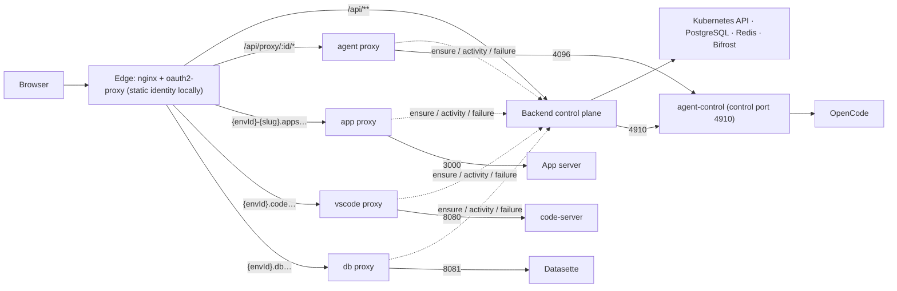

# Request Flows

> How does a browser or program request reach the right ProjectEnvironment pod, and what does each surface do on the way?

## How it works

### Topology

- The edge routes `/api/**` to the NestJS backend and every project surface to one of four stateless Go runtime proxies; the backend is a control plane that never streams project traffic.
- The agent surface is path-routed under `/api/proxy/:id/*`; the App, VS Code and DB surfaces are subdomain-routed because their servers emit absolute asset paths ([Pod Tools](pod-tools.md)). `:id` is always the [ProjectEnvironment](../../CONTEXT.md) id, which for [Development](../../CONTEXT.md) equals the [Project](../../CONTEXT.md) id ([ADR-0002](../adr/0002-development-environment-reuses-project-id.md)).
- Inside the pod, agent-control listens on the control port (4910) for App restarts and status pushes and fronts OpenCode on 4096 ([OpenCode Embed](../frontend/opencode-embed.md)); the App serves on 3000, code-server on 8080 and Datasette on 8081.
- Hosted deployments put oauth2-proxy at the edge; local development runs the edge in static auth mode with no identity provider and a fixed identity carrying every permission ([ADR-0050](../adr/0050-local-development-runs-on-tilt-with-a-static-identity-and-no-identity-provider.md), [Local orchestration](../operations/local-orchestration.md)).

### The ensure gate

- Every proxy calls the backend's ensure endpoint before forwarding; the gate dispatches on the environment's status and wakes, waits or fails ([Pod Lifecycle](pod-lifecycle.md)).
- The gate touches one of the environment's two Redis keep-alive keys: App traffic touches the app key, every other surface the agent key ([Keep-alive activity](../../CONTEXT.md)).
- Each proxy counts open WebSocket connections per environment and surface and re-touches that surface's activity through the activity endpoint on a fixed cadence (default one minute), so an open Code tab keeps the pod up.
- Idle timeouts are validated against a five-minute floor wherever they are written, so several keep-alive touches fit inside the shortest timeout anyone can configure.
- Each proxy caches a ready decision for about five seconds and a starting decision for about one second, and collapses concurrent ensures for the same environment, surface and auth signature into one backend call.
- The proxy forwards the edge's identity headers, and the backend gates the runtime path by [Organization](../../CONTEXT.md) membership and the same Project visibility predicate the Project list uses ([Connection](../public-api/connection.md)).
- When a live request fails mid-stream the proxy reports it to the failure endpoint; the backend re-reads the pod and answers 503 for a gone pod being recreated or 502 for a dead process inside a Ready pod.

### Per surface

- Chat reaches OpenCode on 4096 through the agent proxy and touches agent activity.
- The in-product App preview uses a dedicated preview hostname without [App Auth](../../CONTEXT.md); the public App uses `{envId}-{slug}` on the apps domain, where App Auth attaches its middleware ([Environments](../projects/environments.md)). Both touch app activity.
- VS Code and the DB viewer reach 8080 and 8081 through their subdomain proxies and touch agent activity; code-server's WebSocket holds the pod while the page is open.
- Uploading, listing, deleting and reading workspace files are backend filesystem paths on the shared volume that never wake a pod ([Files](../projects/files.md), [File preview](../projects/file-preview.md)).
- Deleting a Project deletes every environment's pod, clears keep-alive keys, revokes the Bifrost team and tombstones each environment before removing the row ([Persistence](persistence.md)).

## Edge cases

- When a request arrives while the environment is starting, the proxy answers 503 with `Retry-After` and the frontend retries.
- When the last WebSocket of a surface closes, that surface falls back to its plain idle timeout.
- When the Kubernetes API is unavailable, ensure answers 5xx and nothing else compensates; the frontend retries.
- When a client vanishes without closing (sleep, network loss), TCP keepalive detects it within a few minutes and the surface falls back to its idle timeout.

## Code

- `backend/src/proxy/` — the ensure, activity and failure endpoints the proxies call.
- `backend/src/timeout/` — the two keep-alive keys and the idle-timeout floor.
- `proxy/internal/server/` — the Go runtime proxy: routing modes, decision cache, WebSocket keep-alive, failure reporting.
- `proxy/cmd/agent-control/` — the in-pod control port and the OpenCode front proxy.
- `helm/opsiforce-proxy/` — the edge: oauth2-proxy and static auth mode.

## Related

- [Pod Lifecycle](pod-lifecycle.md) — the status model, recovery and suspension behind the ensure gate.
- [Pod Tools](pod-tools.md) — the processes in the pod and why two surfaces are subdomain-routed.
- [Persistence](persistence.md) — what survives a pod swap and how teardown retains files.
- [Environments](../projects/environments.md) — public hostnames and App Auth.
- [Connection](../public-api/connection.md) — how a program reaches the same runtime path.
- [Local orchestration](../operations/local-orchestration.md) — bringing the local stack up in static mode.
