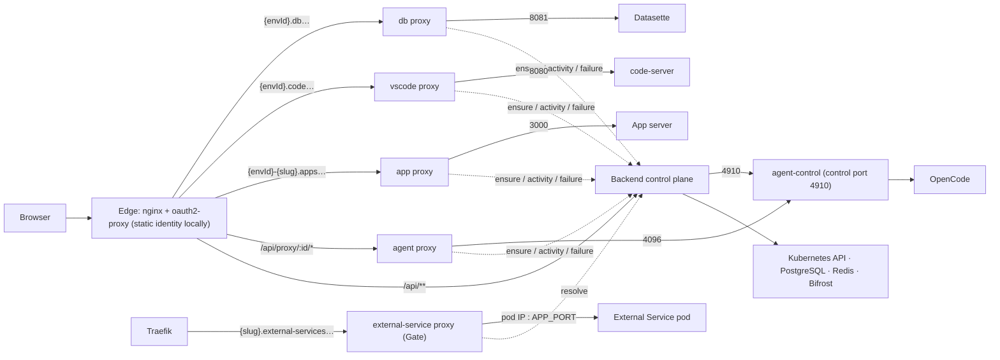

# Request Flows

> How does a browser or program request reach the right ProjectEnvironment pod, and what does each surface do on the way?

## How it works

### Topology

- The edge routes `/api/**` to the NestJS backend and every project surface to one of four stateless Go runtime proxies; the backend is a control plane that never streams project traffic.
- A fifth mode of the same binary, the `external-service` proxy (the Gate's proxy), serves every [Service host](../../GLOSSARY.md) `<slug>.external-services.<base>`. Traefik routes that host family to it directly, with no identity proxy in front, and it reaches the service's pod by IP (see [Service hosts](#service-hosts)). Its second port (3008) is the webhook lane: Traefik sends the main host's `/api/external-services/webhooks/**` there, also with no identity proxy in front ([Event](../external-services/events.md)).
- The agent surface is path-routed under `/api/proxy/:id/*`; the App, VS Code and DB surfaces are subdomain-routed because their servers emit absolute asset paths ([Pod Tools](pod-tools.md)). `:id` is always the [ProjectEnvironment](../../GLOSSARY.md) id, which for [Development](../../GLOSSARY.md) equals the [Project](../../GLOSSARY.md) id ([ADR-0002](../adr/0002-development-environment-reuses-project-id.md)).
- Inside the pod, agent-control listens on the control port (4910) for App restarts and status pushes and fronts OpenCode on 4096 ([OpenCode Embed](../frontend/opencode-embed.md)); the App serves on 3000, code-server on 8080 and Datasette on 8081.
- Hosted deployments put oauth2-proxy at the edge, waiting up to 2 minutes for the backend's first byte so a request the backend holds on purpose (an External Service's Default switch drains for up to 30 s) is not cut into a `502`; local development runs the edge in static auth mode with no identity provider and a fixed identity carrying every permission ([ADR-0050](../adr/0050-local-development-runs-on-tilt-with-a-static-identity-and-no-identity-provider.md), [Local orchestration](../operations/local-orchestration.md)).

### The ensure gate

- Every proxy calls the backend's ensure endpoint before forwarding; the gate dispatches on the environment's status and wakes, waits or fails ([Pod Lifecycle](pod-lifecycle.md)).
- The gate touches one of the environment's two Redis keep-alive keys: App traffic touches the app key, every other surface the agent key ([Keep-alive activity](../../GLOSSARY.md)).
- Each proxy counts open WebSocket connections per environment and surface and re-touches that surface's activity through the activity endpoint on a fixed cadence (default one minute), so an open Code tab keeps the pod up.
- Idle timeouts are validated against a five-minute floor wherever they are written, so several keep-alive touches fit inside the shortest timeout anyone can configure.
- Each proxy caches a ready decision for about five seconds and a starting decision for about one second, and collapses concurrent ensures for the same environment, surface and auth signature into one backend call. A request carrying a pod's `gw-` key is never cached: the backend checks its *Manage created Projects* setting on every request ([API Token](../public-api/api-token.md)).
- The proxy forwards the edge's identity headers, and the backend gates the Agent surface only, not Code or DB, by [Organization](../../GLOSSARY.md) membership, the same Project visibility predicate the Project list uses, and — for a [Builder chat](../../GLOSSARY.md) or the Test Project under it — whether its Skill or Agent is visible to the caller: a failed membership or visibility check answers 404, a hidden Builder chat or Test Project 403 ([Connection](../public-api/connection.md), [ADR-0064](../adr/0064-a-builder-chat-is-a-kind-stamped-project-that-belongs-to-one-skill-or-agent-and-who-opens-it-follows-that-subject.md)).
- The App surface is not gated there at all: its hostname reaches the app proxy without passing the identity proxy, so the headers arriving on it are caller-supplied. It is guarded per environment by [App Auth](../../GLOSSARY.md) instead ([Environments](../projects/environments.md)).
- An External Service's Projects (any ProjectEnvironment of a builder chat) answer 404 on the App surface, so a service's pod is reachable only through its Service host.
- When a live request fails mid-stream the proxy reports it to the failure endpoint; the backend re-reads the pod and answers 503 for a gone pod being recreated or 502 for a dead process inside a Ready pod.

### Service hosts

- A pod or any other client calls `https://<slug>.$EXTERNAL_SERVICES_HOST` with its [Gateway Key](../../GLOSSARY.md) in any request header. Pods get `EXTERNAL_SERVICES_HOST=external-services.<base>` (backend setting `externalServicesHost`).
- The Gate looks for a `gw-…` value in every header, `Authorization: Basic` decoded first (username or password), never in the URL or body. It sends that header's value and the host's first label to the backend's resolve endpoint, which answers the pod's address and a freshly minted Caller identity, or a refusal. For a built-in (`public-api`, `incoming-email`, `whatsapp`) the answer is `servedBy: "built-in"` with a backend path, and the Gate forwards to the backend at that path plus the request's own (the built-ins adapter, [Call log](../external-services/call-log.md#built-ins)); the webhook lane does the same.
- It removes the header the key was in and every incoming `X-Opsiforce-*` header, adds `X-Opsiforce-Caller`, and forwards everything else untouched over HTTP/1.1: method, path, query, headers, body, chunked and gzip uploads, any `Upgrade`, the original `Host` with `X-Forwarded-Host`/`-Proto`. Answers of every status come back untouched and streamed with an immediate flush; it adds no CORS headers and forwards `OPTIONS`.
- The path it forwards is the one Traefik hands on: Traefik's path sanitizing, on by default, resolves `.` and `..` segments at the edge, so a dot-segment path reaches the service already resolved and is judged on its real target ([Gate](../external-services/gate.md#edge-cases)).
- Its only own answers are `{"message"}` bodies: 401 with `WWW-Authenticate: Basic realm="Opsiforce"` (no key, or the backend refused it), 404 (no such service for the caller's Organization, disabled, deleted, never published), 502 (the pod refused the connection) and 504 (not ready within the hold). The backend holds a waking pod for up to 60 s; the Gate waits 65 s for that answer.
- It caches a resolve answer for at most 5 s by key and slug (a webhook resolve by address), never a refusal. The backend evicts entries at once with `POST /evict` (`{tenantId, slug}`, which also drops that service's webhook resolves, or `{gatewayKey}`, `x-proxy-control-token`) on the control port 3007, which also serves `/health`; the headless `<release>-external-service-control` Service names every replica, and the backend posts to each address its name resolves to (backend setting `externalServiceProxyControl`, `EXTERNAL_SERVICE_PROXY_CONTROL` = `host:port`, unset = no eviction). It evicts the service on its Disable and Delete, a key on its Rotate (and the service too when the key is a service pod's own) and every key of a Project on the Project's disable; a missed replica falls back to the 5 s life. A pod that refuses the connection drops its entry.
- It keeps no request log and sets no size, duration or first-byte limit; Traefik's read timeout on the public entrance is off so long uploads are not cut. It closes an idle connection to a pod after 60 s, before the SDK server's 75 s keep-alive ends, and the SDK never times a request out.

### Per surface

- Chat reaches OpenCode on 4096 through the agent proxy and touches agent activity.
- The in-product App preview uses a dedicated preview hostname without [App Auth](../../GLOSSARY.md); the public App uses `{envId}-{slug}` on the apps domain, where App Auth attaches its middleware ([Environments](../projects/environments.md)). Both touch app activity.
- VS Code and the DB viewer reach 8080 and 8081 through their subdomain proxies and touch agent activity; code-server's WebSocket holds the pod while the page is open.
- Uploading, listing, deleting and reading workspace files are backend filesystem paths on the shared volume that never wake a pod ([Files](../projects/files.md), [File preview](../projects/file-preview.md)).
- Deleting a Project deletes every environment's pod, clears keep-alive keys, revokes the Bifrost team and tombstones each environment before removing the row ([Persistence](persistence.md)).

## Edge cases

- When a request arrives while the environment is starting, the proxy answers 503 with `Retry-After` and the frontend retries.
- When the last WebSocket of a surface closes, that surface falls back to its plain idle timeout.
- When the Kubernetes API is unavailable, ensure answers 5xx and nothing else compensates; the frontend retries.
- When a client vanishes without closing (sleep, network loss), TCP keepalive detects it within a few minutes and the surface falls back to its idle timeout.

## Code

- `backend/src/proxy/` — the ensure, activity and failure endpoints the proxies call, and the Apps-host refusal for an External Service's Projects.
- `backend/src/timeout/` — the two keep-alive keys and the idle-timeout floor.
- `proxy/internal/server/` — the Go runtime proxy: routing modes, decision cache, WebSocket keep-alive, failure reporting.
- `proxy/internal/gate/` — the `external-service` mode: finding the key, the caller cache, forwarding, the webhook lane, the control port.
- `proxy/cmd/agent-control/` — the in-pod control port and the OpenCode front proxy.
- `helm/opsiforce-proxy/` — the edge: oauth2-proxy and static auth mode.

## Related

- [Pod Lifecycle](pod-lifecycle.md) — the status model, recovery and suspension behind the ensure gate.
- [Pod Tools](pod-tools.md) — the processes in the pod and why two surfaces are subdomain-routed.
- [Persistence](persistence.md) — what survives a pod swap and how teardown retains files.
- [Environments](../projects/environments.md) — public hostnames and App Auth.
- [Connection](../public-api/connection.md) — how a program reaches the same runtime path.
- [Local orchestration](../operations/local-orchestration.md) — bringing the local stack up in static mode.
