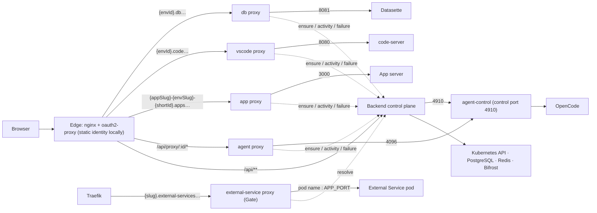

# Request Flows

> How does a browser or program request reach the right ProjectEnvironment pod, and what does each surface do on the way?

## How it works

### Topology

- The edge routes `/api/**` to the NestJS backend and every project surface to one of four stateless Go runtime proxies; the backend is a control plane that never streams project traffic.
- A fifth mode of the same binary, the `external-service` proxy (the Gate's proxy), serves every [Service host](../../GLOSSARY.md) `<slug>.external-services.<base>` with no identity proxy in front, plus the webhook lane, and reaches the service's pod by its DNS name ([Service host](service-host.md)).
- The agent surface is path-routed under `/api/proxy/:id/*`; the App, VS Code and DB surfaces are subdomain-routed because their servers emit absolute asset paths ([Pod Tools](pod-tools.md)). `:id` is always the [ProjectEnvironment](../../GLOSSARY.md) id, which for [Development](../../GLOSSARY.md) equals the [Project](../../GLOSSARY.md) id ([ADR-0002](../adr/0002-development-environment-reuses-project-id.md)).
- Inside the pod, agent-control listens on the control port (4910) for App restarts and config-change markers and fronts OpenCode on 4096 ([OpenCode Embed](../frontend/opencode-embed.md)); the App serves on 3000, code-server on 8080 and Datasette on 8081.
- The four runtime proxies and the backend connect to a pod by its DNS name and ask for `Host: localhost:<port>`, so a stack's default host check accepts them; the runtime proxies pass the public address on in `X-Forwarded-Host` and `X-Forwarded-Proto`, and the Gate keeps the caller's `Host` ([ADR-0094](../adr/0094-agent-pods-are-reached-by-dns-name-and-the-database-stores-no-address.md)).
- Hosted deployments put oauth2-proxy at the edge, waiting up to 2 minutes for the backend's first byte so a request the backend holds on purpose (an External Service's Default switch drains for up to 30 s) is not cut into a `502`; local development runs the edge in static auth mode with no identity provider and a fixed identity carrying every permission ([ADR-0050](../adr/0050-local-development-runs-on-tilt-with-a-static-identity-and-no-identity-provider.md), [Local orchestration](../operations/local-orchestration.md)).

### The ensure gate

- Every proxy calls the backend's ensure endpoint before forwarding; the gate dispatches on the environment's status and wakes, waits or fails ([Pod Lifecycle](pod-lifecycle.md)).
- The gate touches one of the environment's two Redis keep-alive keys: App traffic touches the app key, every other surface the agent key ([Keep-alive activity](../../GLOSSARY.md)). Each proxy counts open WebSocket connections per environment and surface and re-touches that surface's activity through the activity endpoint on a fixed cadence (default one minute), so an open Code tab keeps the pod up.
- A held `/api/event` SSE stream is one agent touch at connect and is not re-touched: a program waiting on a run is covered instead by the backend re-touching the agent key while the Agent is Working ([Agent Status](../agent-system/agent-status.md)).
- Idle timeouts are validated against a five-minute floor wherever they are written, so several keep-alive touches fit inside the shortest timeout anyone can configure.
- Each proxy caches a ready decision for about five seconds and a starting decision or an App redirect for about one second, in at most 10,000 entries with expired ones dropped first, collapses concurrent ensures for the same environment, surface and auth signature (on the App surface, the same host) into one backend call, and drops every cached decision for an environment on its failure report. A request carrying a pod's `gw-` key is never cached, because the backend checks its *Manage created Projects* setting on every request ([API Token](../public-api/api-token.md)).
- The proxy forwards the edge's identity headers, and the backend gates the Agent surface only, not Code or DB, by [Organization](../../GLOSSARY.md) membership, the same Project visibility predicate the Project list uses, and — for a [Builder chat](../../GLOSSARY.md) or the Test Project under it — whether its Skill or Agent is visible to the caller: a failed membership or visibility check answers 404, a hidden Builder chat or Test Project 403 ([Connection](../public-api/connection.md), [ADR-0064](../adr/0064-a-builder-chat-is-a-kind-stamped-project-that-belongs-to-one-skill-or-agent-and-who-opens-it-follows-that-subject.md)).
- The App surface is not gated there at all: its hostname reaches the app proxy without passing the identity proxy, so the headers arriving on it are caller-supplied. It is guarded per environment by [App Auth](../../GLOSSARY.md) instead, and the catch-all apps route, which has no App Auth, sets `X-Opsiforce-Unprotected-Route` on every request it passes, so the app proxy answers 403 for an App whose App Auth is not public and strips the header with every reserved `X-Opsiforce-*` one ([Environments](../projects/environments.md)).
- The app proxy sends the full host a visitor opened to `POST /internal/proxy/apps/ensure`, with the same identity headers and `gw-` bearer, and serves, redirects with a 308 marked `no-store` or passes the 404 on as the backend answers ([Public URL](../projects/public-url.md)); an External Service's Projects get that 404 on every host and on either ensure route. It checks the forwarded-token proof against the answered `environmentId`, which also names the environment in its failure and activity calls, while the per-environment route keeps answering an App's legacy host as `canonicalHost`.

### Per surface

- Chat reaches OpenCode on 4096 through the agent proxy, and VS Code and the DB viewer reach 8080 and 8081 through their subdomain proxies; all three touch agent activity, and code-server's WebSocket holds the pod while the page is open.
- The in-product App preview frames `{environmentId}` on the preview apps domain, which the backend serves by id without [App Auth](../../GLOSSARY.md); the public App uses its [Public URL](../../GLOSSARY.md) on the apps domain, or either legacy host, where App Auth attaches its middleware ([Environments](../projects/environments.md)). Both touch app activity and lose the edge's session cookies, which the browser sends to every host under the platform's parent domain: `_opsiforce_` is a cookie prefix reserved for the platform on App hosts, so the edge's `oauth2Proxy.cookieName` starts with it, and the app proxy deletes every cookie whose name does (its split and CSRF cookies included) before App code sees the request, over HTTP and WebSocket alike.
- Uploading, listing, deleting and reading workspace files are backend filesystem paths on the shared volume that never wake a pod ([Files](../projects/files.md), [File preview](../projects/file-preview.md)).

## Edge cases

- When a request arrives while the environment is starting, the proxy answers 503 with `Retry-After` and the frontend retries.
- When a live request fails mid-stream, the proxy reports it to the failure endpoint, and the backend re-reads the pod and answers 503 for a gone pod being recreated or 502 for a dead process inside a Ready pod.
- When the last WebSocket of a surface closes, that surface falls back to its plain idle timeout.
- When the Kubernetes API is unavailable, ensure answers 5xx and nothing else compensates; the frontend retries.
- When a client vanishes without closing (sleep, network loss), TCP keepalive detects it within a few minutes and the surface falls back to its idle timeout.
- When a Project is deleted, every environment's pod is deleted, its keep-alive keys are cleared, the Bifrost team is revoked and each environment is tombstoned before its row goes ([Persistence](persistence.md)).
- When an App sets a cookie of its own named `_opsiforce_…`, the app proxy deletes it from every request to that App.

## Code

- `backend/src/proxy/` — the ensure, activity and failure endpoints the proxies call, App address resolution by host, and the Apps-host refusal for an External Service's Projects.
- `backend/src/timeout/` — the two keep-alive keys and the idle-timeout floor.
- `proxy/internal/server/` — the Go runtime proxy: routing modes, following the backend's App address answer, decision cache, WebSocket keep-alive, failure reporting, removing the platform's session cookies on the App surface.
- `proxy/cmd/agent-control/` — the in-pod control port and the OpenCode front proxy.
- `helm/opsiforce-proxy/` — the edge: oauth2-proxy, static auth mode, and the catch-all apps route with its unprotected-route marker.

## Related

- [Pod Lifecycle](pod-lifecycle.md) — the status model, recovery and suspension behind the ensure gate.
- [Pod Tools](pod-tools.md) — the processes in the pod and why two surfaces are subdomain-routed.
- [Persistence](persistence.md) — what survives a pod swap and how teardown retains files.
- [Public URL](../projects/public-url.md) — the addresses an App answers on, its App Slug and Edit URL.
- [Connection](../public-api/connection.md) — how a program reaches the same runtime path.
- [Local orchestration](../operations/local-orchestration.md) — bringing the local stack up in static mode.
